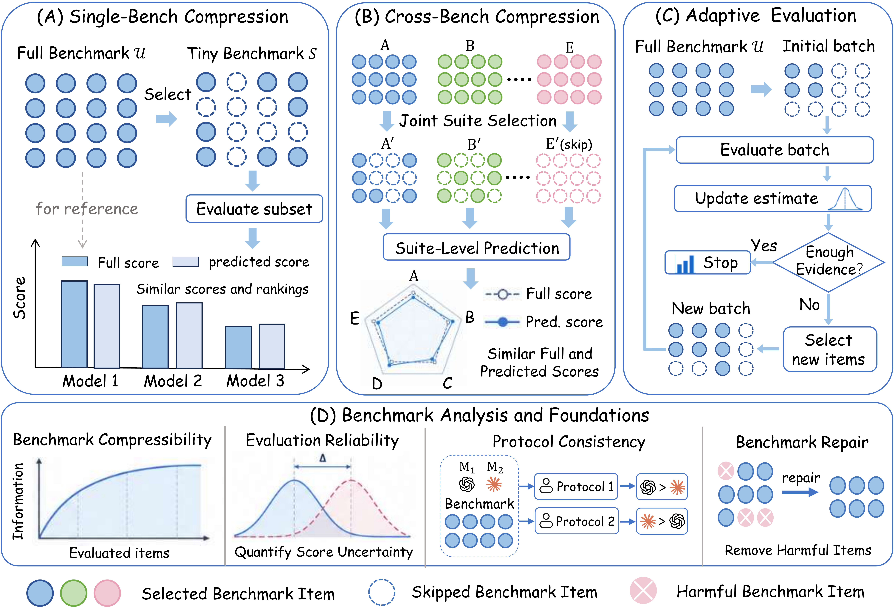

# Awesome-Benchmark-Compression

A curated list of awesome works in benchmark compression for efficient LLM evaluation.

🤩👉 Welcome to submit your contributions to this code repository.



---

## Survey

| Paper | Conference/Journal | Code |
| :--- | :--- | :---: |
| [Are We Testing Too Much? A Survey of Benchmark Compression for Efficient Evaluation of Large Language Models](https://arxiv.org/abs/2610.18248) | arXiv 2026 | [Code](https://github.com/MilkThink-Lab/Awesome-Benchmark-Compression) |

## Single-Benchmark Compression

Reduce the cost of evaluating one benchmark using a subset chosen before the main evaluation.

### Content-Based Compression

Choose evaluation items using benchmark content or a sampling design, without historical model responses or a target-specific signal.

| Paper | Venue | Domain | Code |
| :--- | :--- | :--- | :---: |
| [Consistent and Distinctive: LLM Benchmark Efficiency via Maximum Independent Set Prompt Selection on Similarity Graphs](https://arxiv.org/abs/2606.01400) | arXiv 2026 | General, Reasoning, Math | — |
| [CoT-Core: Accelerating LLM Evaluation via CoT-Aware Coreset Selection](https://arxiv.org/abs/2608.00014) | arXiv 2026 | General, QA, Reasoning, Math | — |
| [Noisy but Valid: Robust Statistical Evaluation of LLMs with Imperfect Judges](https://proceedings.iclr.cc/paper_files/paper/2026/hash/08a67eb74bfb9ded9e949dd52973e997-Abstract-Conference.html) | ICLR 2026 | Safety | — |
| [Robust LLM Performance Certification via Constrained Maximum Likelihood Estimation](https://arxiv.org/abs/2604.03257) | arXiv 2026 | Safety | — |
| [Select, Label, Evaluate: Active Testing in NLP](https://arxiv.org/abs/2603.21840) | arXiv 2026 | General, NLG | [GitHub](https://github.com/amazon-science/NLPActiveTesting) |
| [Statistically Reliable LLM-Based Ranking Evaluation via Prediction-Powered Inference](https://arxiv.org/abs/2606.05308) | ACL Workshop (GEM) 2026 | Retrieval | — |
| [EffiEval: Efficient and Generalizable Model Evaluation via Capability Coverage Maximization](https://arxiv.org/abs/2508.09662) | arXiv 2025 | General, QA, Reasoning, Math | — |
| [Scales++: Compute Efficient Evaluation Subset Selection with Cognitive Scales Embeddings](https://arxiv.org/abs/2510.26384) | arXiv 2025 | General, QA, Reasoning, Math | — |
| [ARES: An Automated Evaluation Framework for Retrieval-Augmented Generation Systems](https://aclanthology.org/2024.naacl-long.20/) | NAACL 2024 | RAG, Retrieval | [GitHub](https://github.com/stanford-futuredata/ARES) |
| [Efficient multi-prompt evaluation of LLMs](https://papers.nips.cc/paper_files/paper/2024/hash/28236482f64a72eec43706b6f3a6c511-Abstract-Conference.html) | NeurIPS 2024 | General, QA, Reasoning | [GitHub](https://github.com/felipemaiapolo/prompteval) |

### Historical-Response Compression

Reuse earlier models' evaluation results to select items or estimate the results of a new model.

| Paper | Venue | Domain | Code |
| :--- | :--- | :--- | :---: |
| [Zipbench: Low-Cost Framework for Compressing Comprehensive Benchmarks of Large Language Models](https://arxiv.org/abs/2609.12475) | EMNLP 2026 Oral | General, Multimodal, Agent | [GitHub](https://github.com/MilkThink-Lab/ZipBench) |
| [MiniLongBench: The Low-cost Long Context Understanding Benchmark for Large Language Models](https://aclanthology.org/2025.acl-long.560/) | ACL 2025 Outstanding Paper | General, QA, Retrieval | [GitHub](https://github.com/MilkThink-Lab/MiniLongBench) |
| [SubLIME: Subset Selection via Rank Correlation Prediction for Data-Efficient LLM Evaluation](https://aclanthology.org/2025.acl-long.1477/) | ACL 2025 Best Theme Paper | General, QA, Reasoning, Math | — |
| [Active Testing of Large Language Models via Approximate Neyman Allocation](https://arxiv.org/abs/2605.10075) | arXiv 2026 | General, QA, Reasoning, Multimodal | — |
| [CollabEval: Statistically Efficient Collaborative Model Evaluation via Matrix Completion](https://arxiv.org/abs/2607.05046) | arXiv 2026 | General, QA, Code, Human Eval | — |
| [DatBench: Discriminative, Faithful, and Efficient VLM Evaluations](https://arxiv.org/abs/2601.02316) | arXiv 2026 | Multimodal, VQA | [GitHub](https://github.com/datologyai/DatBench) |
| [DISCO: Diversifying Sample Condensation for Efficient Model Evaluation](https://proceedings.iclr.cc/paper_files/paper/2026/hash/19c145aaad40927c51f4d10eaa339c20-Abstract-Conference.html) | ICLR 2026 | General, QA, Reasoning | [GitHub](https://github.com/arubique/disco-public) |
| [Efficient Benchmarking Is Just Feature Selection and Multiple Regression](https://arxiv.org/abs/2605.25773) | arXiv 2026 | General, QA, Reasoning, Code | [GitHub](https://github.com/sambowyer/mrmr_eval) |
| [Efficient Benchmarking of AI Agents](https://arxiv.org/abs/2603.23749) | arXiv 2026 | Code, Agent | [GitHub](https://github.com/fsndzomga/efficient-benchmarking-ai-agents) |
| [Every Wrong Answer Counts: Option-Level Psychometrics for LLM Multiple-Choice Benchmarks](https://arxiv.org/abs/2608.02966) | arXiv 2026 | General, QA, Reasoning, Math | — |
| [From Uncertain Judgments to Calibrated Rankings: Conformal Elo Estimation for LLM Evaluation](https://arxiv.org/abs/2606.13221) | arXiv 2026 | Chat, Human Eval | [GitHub](https://github.com/kargibora/SoftElo) |
| [Learning More from Less: Unlocking Internal Representations for Benchmark Compression](https://proceedings.mlr.press/v306/zhang26bj.html) | ICML 2026 | General, QA, Reasoning, Multimodal | — |
| [MetaEval: Measuring the Discrimination of Benchmarks for Efficient LLM Evaluation](https://ojs.aaai.org/index.php/AAAI/article/view/40668) | AAAI 2026 | General, QA, Reasoning, Math | [GitHub](https://github.com/wangzhuo0092/MetaEval) |
| [MINCE: Shrinking LLM Evaluation Datasets via Few-Model Monte Carlo Calibration](https://arxiv.org/abs/2606.22826) | EMNLP Industry 2026 | General, QA, Reasoning, Math | — |
| [Rethinking LLM Evaluation: Can We Evaluate LLMs with 200× Less Data?](https://proceedings.iclr.cc/paper_files/paper/2026/hash/b260b381bee9f64b1a1ef66a8de21133-Abstract-Conference.html) | ICLR 2026 | General, QA, Reasoning, Math | — |
| [SparseEval: Efficient Evaluation of Large Language Models by Sparse Optimization](https://proceedings.iclr.cc/paper_files/paper/2026/hash/b059de4629cccb411ef92d0d4157e87e-Abstract-Conference.html) | ICLR 2026 | General, QA, Reasoning, Math | [GitHub](https://github.com/taolinzhang/SparseEval) |
| [Causal Judge Evaluation: Calibrated Surrogate Metrics for LLM Systems](https://arxiv.org/abs/2512.11150) | arXiv 2025 | General, Chat, Code, Human Eval | [GitHub](https://github.com/cimo-labs/cje) |
| [Efficient Benchmarking via Bias-Bounded Subset Selection](https://doi.org/10.1109/TPAMI.2025.3598031) | TPAMI 2025 | General, QA, Reasoning | [GitHub](https://github.com/54zy/Subset4Eval) |
| [Efficiently Ranking Software Variants with Minimal Benchmarks](https://arxiv.org/abs/2509.06716) | arXiv 2025 | Code, Software Eng. | — |
| [How Benchmark Prediction from Fewer Data Misses the Mark](https://papers.nips.cc/paper_files/paper/2025/hash/c57bacb5ea621582235c54ce2a83136d-Abstract-Conference.html) | NeurIPS 2025 | General, QA, Reasoning | [GitHub](https://github.com/socialfoundations/benchmark-prediction) |
| [Improving Model Evaluation using SMART Filtering of Benchmark Datasets](https://aclanthology.org/2025.naacl-long.235/) | NAACL 2025 | General, QA, Reasoning | [GitHub](https://github.com/facebookresearch/ResponsibleNLP/tree/main/SMART-Filtering) |
| [Jailbreak Distillation: Renewable Safety Benchmarking](https://aclanthology.org/2025.findings-emnlp.1366/) | EMNLP Findings 2025 | Safety, Security | — |
| [Psychometrically derived 60-question benchmarks: Substantial efficiencies and the possibility of human-AI comparisons](https://doi.org/10.1016/j.intell.2025.101922) | Intelligence 2025 | General, QA, Reasoning, Math | — |
| [Scaling Up Active Testing to Large Language Models](https://papers.nips.cc/paper_files/paper/2025/hash/fdb11be1acf5e3724737dd585e590146-Abstract-Conference.html) | NeurIPS 2025 | General, QA, Reasoning | [GitHub](https://github.com/gabrielleberrada/scaling-up-active-testing) |
| [Towards Optimal Evaluation Efficiency for Large Language Models](https://aclanthology.org/2025.emnlp-main.716/) | EMNLP 2025 | General, QA, Reasoning, Math | — |
| [Anchor Points: Benchmarking Models with Much Fewer Examples](https://aclanthology.org/2024.eacl-long.95/) | EACL 2024 | General, QA, Reasoning | [GitHub](https://github.com/rvivek3/AnchorPoints) |
| [tinyBenchmarks: evaluating LLMs with fewer examples](https://proceedings.mlr.press/v235/maia-polo24a.html) | ICML 2024 | General, QA, Reasoning, Math | [GitHub](https://github.com/felipemaiapolo/tinyBenchmarks) |

### Target-Conditioned Compression

Use a low-cost signal from the model being evaluated to choose its evaluation subset.

| Paper | Venue | Domain | Code |
| :--- | :--- | :--- | :---: |
| [Augmenting Human Evaluation with LLM Judges: How Many Human Reviews Do You Need?](https://arxiv.org/abs/2605.16354) | arXiv 2026 | Medical, Human Eval | — |
| [Generative Active Testing: Efficient LLM Evaluation via Proxy Task Adaptation](https://arxiv.org/abs/2603.19264) | arXiv 2026 | General, QA, Medical | — |
| [How to Correctly Report LLM-as-a-Judge Evaluations](https://proceedings.mlr.press/v306/lee26bl.html) | ICML 2026 | Chat, Human Eval | [GitHub](https://github.com/UW-Madison-Lee-Lab/LLM-judge-reporting) |
| [Industrializing Prediction-Powered Inference: The GLIDE Library for Reliable GenAI and Agentic Systems Evaluation](https://arxiv.org/abs/2605.31278) | ICML Workshop (AgenticUQ) 2026 | Agent, Safety | [GitHub](https://github.com/EmertonData/glide) |
| [Metric Match: A Subset Selection Approach to Evaluating LLM Judge Reliability](https://arxiv.org/abs/2606.15029) | arXiv 2026 | General, Human Eval | [GitHub](https://github.com/som-shahlab/MetricMatch) |
| [Accelerating Unbiased LLM Evaluation via Synthetic Feedback](https://proceedings.mlr.press/v267/zhou25v.html) | ICML 2025 | Chat, Human Eval | [GitHub](https://github.com/Zanette-Labs/control_variates_evaluation) |
| [AutoEval Done Right: Using Synthetic Data for Model Evaluation](https://proceedings.mlr.press/v267/boyeau25a.html) | ICML 2025 | General, Chat | [GitHub](https://github.com/PierreBoyeau/autoeval) |
| [Beyond One-Size-Fits-All: Tailored Benchmarks for Efficient Evaluation](https://aclanthology.org/2025.acl-long.759/) | ACL 2025 | General, Math, Multimodal | [GitHub](https://github.com/marvelcell/TailoredBench) |
| [Cost-Optimal Active AI Model Evaluation](https://arxiv.org/abs/2506.07949) | arXiv 2025 | General, Chat | — |
| [Evaluating multiple models using labeled and unlabeled data](https://proceedings.neurips.cc/paper_files/paper/2025/hash/2c0e78cc177dfeca260ef990a8c99209-Abstract-Conference.html) | NeurIPS 2025 | General, NLP | [GitHub](https://github.com/divyashan/SSME) |
| [QuEst: Enhancing Estimates of Quantile-Based Distributional Measures Using Model Predictions](https://proceedings.mlr.press/v267/deng25k.html) | ICML 2025 | General, Safety, NLG | [GitHub](https://github.com/btleyre/quest) |
| [Regression for the Mean: Auto-Evaluation and Inference with Few Labels through Post-hoc Regression](https://proceedings.mlr.press/v267/eyre25a.html) | ICML 2025 | General | — |
| [Sample-Efficient Human Evaluation of Large Language Models via Maximum Discrepancy Competition](https://aclanthology.org/2025.acl-long.535/) | ACL 2025 | General, Math, Code, Human Eval | [GitHub](https://github.com/weiji-Feng/MAD-Eval) |
| [Smarter Sampling for LLM Judges: Reliable Evaluation on a Budget](https://openreview.net/forum?id=2aBTwSOL0e) | NeurIPS Workshop (LLM Eval) 2025 | General, Human Eval | — |
| [Label-Efficient Model Selection for Text Generation](https://aclanthology.org/2024.acl-long.456/) | ACL 2024 | General, NLG, Human Eval | — |

## Cross-Benchmark Compression

Reduce evaluation across multiple benchmarks through shared selection, prediction, or evidence reuse.

| Paper | Venue | Domain | Code |
| :--- | :--- | :--- | :---: |
| [Coresets Before Score Sets: Evaluation-Unsupervised Prompt Subset Selection for LLM Benchmarks](https://arxiv.org/abs/2607.09739) | arXiv 2026 | General | — |
| [Extending Item Response Theory for Efficient and Meaningful Multilingual Evaluation](https://arxiv.org/abs/2606.15643) | arXiv 2026 | General, QA, Knowledge, Translation | — |
| [From Benchmarks to Skills: Low-Rank Factors for LLM Evaluation](https://aclanthology.org/2026.tacl-1.75/) | TACL 2026 | General | — |
| [Growing Pains: Extensible and Efficient LLM Benchmarking Via Fixed Parameter Calibration](https://arxiv.org/abs/2604.12843) | arXiv 2026 | General, QA, Reasoning, Math | [GitHub](https://github.com/eliyahabba/growing-pains) |
| [Lost in Benchmarks? Rethinking Large Language Model Benchmarking with Item Response Theory](https://ojs.aaai.org/index.php/AAAI/article/view/40814) | AAAI 2026 | General, QA, Reasoning, Math | [GitHub](https://github.com/Joe-Hall-Lee/PSN-IRT) |
| [PACE: A Proxy for Agentic Capability Evaluation](https://arxiv.org/abs/2607.02032) | arXiv 2026 | Reasoning, Code, Agent | — |
| [Submodular Benchmark Selection](https://arxiv.org/abs/2605.02209) | arXiv 2026 | General | [GitHub](https://github.com/smolix/benchmark-selection) |
| [You Don't Need to Run Every Eval](https://arxiv.org/abs/2606.24020) | arXiv 2026 | General | — |
| [Importance Sampling is All You Need: Predict LLM's performance on new benchmark by reusing existing benchmark](https://arxiv.org/abs/2508.01203) | arXiv 2025 | Code | — |
| [metabench - A Sparse Benchmark of Reasoning and Knowledge in Large Language Models](https://proceedings.iclr.cc/paper_files/paper/2025/hash/4ebc26584810a189ef1e4f173aba4319-Abstract-Conference.html) | ICLR 2025 | General, QA, Reasoning, Math | [GitHub](https://github.com/adkipnis/metabench) |
| [Resampling Benchmark for Efficient Comprehensive Evaluation of Large Vision-Language Models](https://arxiv.org/abs/2504.09979) | arXiv 2025 | Multimodal, VQA | — |
| [SimBA: Simplifying Benchmark Analysis Using Performance Matrices Alone](https://aclanthology.org/2025.findings-emnlp.711/) | EMNLP Findings 2025 | General, QA, Reasoning, Math | [GitHub](https://github.com/nishantsubramani/simba) |
| [Toward a unified framework for data-efficient evaluation of large language models](https://arxiv.org/abs/2510.04051) | arXiv 2025 | General, QA, Knowledge, Translation | [GitHub](https://github.com/Rorschach1989/efficient-lm-eval) |
| [Data Efficient Evaluation of Large Language Models and Text-to-Image Models via Adaptive Sampling](https://arxiv.org/abs/2406.15527) | arXiv 2024 | General, Code | — |

## Adaptive Evaluation

Use results observed during evaluation to decide what to test next or when to stop.

### Adaptive Item Selection

Choose the next evaluation item using the results collected so far.

| Paper | Venue | Domain | Code |
| :--- | :--- | :--- | :---: |
| [AcTracer: Active Testing of Large Language Model via Multi-Stage Sampling](https://doi.org/10.1145/3744340) | TOSEM 2026 | General, QA, Reasoning, Math | [GitHub](https://github.com/YuhengHuang42/test_selection_llm) |
| [Adaptive Testing for LLM Evaluation: A Psychometric Alternative to Static Benchmarks](https://proceedings.mlr.press/v306/li26fx.html) | ICML 2026 | General, QA, Reasoning, Math | [GitHub](https://github.com/Peiyu-Georgia-Li/ATLAS) |
| [Agent psychometrics: Task-level performance prediction in agentic coding benchmarks](https://arxiv.org/abs/2604.00594) | arXiv 2026 | Code, Agent | [GitHub](https://github.com/dariakryvosheieva/agent-psychometrics) |
| [AutoJudger: An Agent-Driven Framework for Efficient Benchmarking of MLLMs](https://aclanthology.org/2026.acl-long.685/) | ACL 2026 | Multimodal, VQA | [GitHub](https://github.com/IMNearth/AutoJudger) |
| [BayesAME: Bayesian Active Model Evaluation](https://arxiv.org/abs/2607.27023) | arXiv 2026 | General, QA, Reasoning, Math | — |
| [Cost-Efficient Estimation of General Abilities Across Benchmarks](https://arxiv.org/abs/2604.01418) | arXiv 2026 | General, QA, Reasoning, Math | — |
| [Efficient Evaluation of LLM Performance with Statistical Guarantees](https://arxiv.org/abs/2601.20251) | arXiv 2026 | General, QA, Reasoning, Math | [GitHub](https://github.com/skbwu/efficiently-evaluating-llms) |
| [Efficient Safety Benchmarking via Item Response Theory](https://arxiv.org/abs/2606.20626) | ICML Workshop (AI4Good) 2026 | Safety | — |
| [Efficient Sequential Evaluation of Large Language Models](https://arxiv.org/abs/2607.17409) | arXiv 2026 | General, QA, Reasoning, Math | — |
| [Evaluating Cross-Modal Reasoning Ability and Problem Characteristics with Multimodal Item Response Theory](https://proceedings.iclr.cc/paper_files/paper/2026/hash/9f07b279e11b1518136e8fdaa619ea5d-Abstract-Conference.html) | ICLR 2026 | Reasoning, Multimodal, VQA | [GitHub](https://github.com/CyberAgentAILab/M3IRT) |
| [FAIR-Eval: Reliable and Efficient Adaptive Benchmarking for Large Language Models](https://openreview.net/forum?id=orBxudKlbh) | OpenReview 2026 | General, QA, Reasoning, Math | — |
| [Item Response Scaling Laws: A Measurement Theory Approach for Efficient and Generalizable Neural Scaling Estimation](https://proceedings.mlr.press/v306/truong26b.html) | ICML 2026 | General, QA, Reasoning, Math | [GitHub](https://github.com/aims-foundations/irsl) |
| [LLM-as-a-Judge on a Budget](https://proceedings.mlr.press/v300/saha26a.html) | AISTATS 2026 | Human Eval | — |
| [Measuring Five-Nines Reliability: Sample-Efficient LLM Evaluation in Saturated Benchmarks](https://arxiv.org/abs/2605.11209) | arXiv 2026 | Math | — |
| [Active Evaluation Acquisition for Efficient LLM Benchmarking](https://proceedings.mlr.press/v267/li25bp.html) | ICML 2025 | General, QA, Reasoning | — |
| [Adaptive Probabilistic Operational Testing for Large Language Models Evaluation](https://doi.org/10.1109/AST66626.2025.00017) | AST 2025 | General | [GitHub](https://github.com/leanerr/OperationalTesting4LLMs) |
| [Beyond Mean Scores: Factor Models for Reliable and Efficient AI Evaluation](https://openreview.net/forum?id=QLSH4qoj77) | OpenReview 2025 | General, QA, Reasoning | — |
| [Cer-Eval: Certifiable and Cost-Efficient Evaluation Framework for LLMs](https://arxiv.org/abs/2505.03814) | arXiv 2025 | General, QA, Reasoning, Math | — |
| [Efficient Evaluation of Large Language Models via Collaborative Filtering](https://arxiv.org/abs/2504.08781) | arXiv 2025 | General, QA, Reasoning, Math | — |
| [Fluid Language Model Benchmarking](https://arxiv.org/abs/2509.11106) | COLM 2025 | General, QA, Reasoning, Math | [GitHub](https://github.com/allenai/fluid-benchmarking) |
| [Reliable and Efficient Amortized Model-based Evaluation](https://proceedings.mlr.press/v267/truong25c.html) | ICML 2025 | General, QA, Reasoning | [GitHub](https://github.com/aims-foundations/reeval) |

### Sequential Decision and Stopping

Allocate evaluation effort to reach a final decision, eliminate candidates, or stop with sufficient evidence.

| Paper | Venue | Domain | Code |
| :--- | :--- | :--- | :---: |
| [AV-AIVAT: 74x Cheaper Agent Evaluation with Certified Anytime-Valid Stopping in Imperfect-Information Games](https://arxiv.org/abs/2608.06362) | arXiv 2026 | Agent | — |
| [CELEUS: Certifiable and Efficient LLM Evaluation via E-Processes](https://arxiv.org/abs/2606.20820) | arXiv 2026 | General, QA | [GitHub](https://github.com/zyecs/celeus) |
| [Confident Rankings with Fewer Items: Adaptive LLM Evaluation with Continuous Scores](https://arxiv.org/abs/2601.13885) | arXiv 2026 | General, QA, Translation, NLG | [GitHub](https://github.com/trismik/continuous-cat) |
| [Cutting LLM Evaluation Costs with SySRs: A Bandit Algorithm That Provably Exploits Model Similarity](https://proceedings.mlr.press/v306/lyu26h.html) | ICML 2026 | General, QA, Reasoning, Math | [GitHub](https://github.com/zifanlyu/llm-bandits-sysrs) |
| [Decentralized Arena: Towards Democratic and Scalable Automatic Evaluation of Language Models](https://aclanthology.org/2026.acl-long.1639/) | ACL 2026 | General, Chat, Reasoning, Math | [GitHub](https://github.com/maitrix-org/de-arena) |
| [Discovering Hidden Gems in Model Repositories](https://arxiv.org/abs/2601.22157) | arXiv 2026 | General, QA, Reasoning, Math | — |
| [ParEvalLayer: When Partial LLM-Agent Evaluations Support a Decision](https://arxiv.org/abs/2608.02444) | AIMLSystems 2026 | Agent, Software Eng. | — |
| [Stop Guessing When to Stop Testing: Efficient Model Evaluation with Just Enough Data](https://aclanthology.org/2026.findings-acl.43/) | ACL Findings 2026 | Multimodal, Vision | [GitHub](https://github.com/OfirArviv/adaptive-eval) |
| [Valid Best-Model Identification for LLM Evaluation via Low-Rank Factorization](https://arxiv.org/abs/2605.10405) | arXiv 2026 | General, QA, Reasoning, Math | [GitHub](https://github.com/elad-tolo/pulse-llm-eval) |
| [Adaptive Prediction-Powered AutoEval with Reliability and Efficiency Guarantees](https://papers.nips.cc/paper_files/paper/2025/hash/e8e81e35728f7559e42ceb265e104d36-Abstract-Conference.html) | NeurIPS 2025 | General, QA, Reasoning, Math | [GitHub](https://github.com/kclip/R_AutoEval_plus) |
| [Arena-lite: Efficient and Reliable Large Language Model Evaluation via Tournament-Based Direct Comparisons](https://aclanthology.org/2025.emnlp-main.360/) | EMNLP 2025 | Chat, Human Eval | — |
| [Large Language Model Selection with Limited Annotations](https://arxiv.org/abs/2510.09418) | arXiv 2025 | General, QA, Reasoning, Math | — |
| [On Speeding Up Language Model Evaluation](https://proceedings.iclr.cc/paper_files/paper/2025/hash/a38cfba4c717e5a37b200294615e546e-Abstract-Conference.html) | ICLR 2025 | General, QA, Reasoning, Math | [GitHub](https://github.com/kilian-group/banditeval) |
| [Trust or Escalate: LLM Judges with Provable Guarantees for Human Agreement](https://proceedings.iclr.cc/paper_files/paper/2025/hash/08dabd5345b37fffcbe335bd578b15a0-Abstract-Conference.html) | ICLR 2025 | Chat, NLG, Human Eval | — |
| [Efficient Benchmarking (of Language Models)](https://aclanthology.org/2024.naacl-long.139/) | NAACL 2024 | General, QA, Reasoning | — |

## Benchmark Analysis and Foundations

Study benchmark redundancy, measurement quality, and the reliability of reduced evaluations.

| Paper | Venue | Domain | Code |
| :--- | :--- | :--- | :---: |
| [An Interpretable and Scalable Framework for Evaluating Large Language Models](https://arxiv.org/abs/2605.07046) | arXiv 2026 | General, Reasoning, Math, Knowledge | — |
| [Benchmark²: Systematic Evaluation of LLM Benchmarks](https://arxiv.org/abs/2601.03986) | arXiv 2026 | General, Reasoning, Math, Knowledge | — |
| [BenchScope: How Many Independent Signals Does Your Benchmark Provide?](https://arxiv.org/abs/2603.29357) | arXiv 2026 | General, Code, Agent | — |
| [Calibrate, Don't Curate: Label-Efficient Estimation from Noisy LLM Judges](https://arxiv.org/abs/2605.09702) | arXiv 2026 | General, Human Eval | — |
| [Can We Trust Item Response Theory for AI Evaluation?](https://arxiv.org/abs/2607.15190) | arXiv 2026 | General, Reasoning, Math, Knowledge | — |
| [Diagnosing LLM Judge Reliability: Conformal Prediction Sets and Transitivity Violations](https://arxiv.org/abs/2604.15302) | ICML Workshop (SCALE) 2026 | General, NLG, Human Eval | — |
| [Does Question Really Matter? The Attribution of Answer Bias in LLM Evaluation](https://ojs.aaai.org/index.php/AAAI/article/view/40262) | AAAI 2026 | General, QA, Reasoning, Knowledge | — |
| [DualEval: Joint Model-Item Calibration for Unified LLM Evaluation](https://arxiv.org/abs/2606.26429) | arXiv 2026 | General, Math, Code, Knowledge | [GitHub](https://github.com/aaron-jx-li/DualEval) |
| [How Many Tasks Are Enough for Agent Benchmark Decisions? A Replay Analysis of Public LLM Agent Benchmarks](https://arxiv.org/abs/2607.12338) | KDD Workshop (Agentic AI) 2026 | Code, Agent | [GitHub](https://github.com/WilliamWJHuang/How-Many-Tasks-Are-Enough-for-Agent-Benchmark-Decisions) |
| [How Reliable is Language Model Micro-Benchmarking?](https://proceedings.iclr.cc/paper_files/paper/2026/hash/2e2960f2fe9e981f33f51c78656e3ca2-Abstract-Conference.html) | ICLR 2026 | General, QA, Reasoning, Math | [GitHub](https://github.com/dill-lab/micro-benchmarking-reliability) |
| [Laplace-PSN-IRT: Uncertainty Quantification for Neural Item Response Theory Models of LLM Benchmarks](https://arxiv.org/abs/2607.25257) | arXiv 2026 | General, QA, Reasoning, Math | [GitHub](https://github.com/JFMandujanoR/Laplace-PSN-IRT/tree/jfmr_laplace) |
| [Resolution Diagnostics for Paired LLM Evaluation](https://arxiv.org/abs/2605.30315) | ICML Workshop (Hypothesis Testing) 2026 | General, QA, Reasoning, Math | [GitHub](https://github.com/ananykotawala/llm-power) |
| [Stop Comparing LLM Agents Without Disclosing the Harness](https://arxiv.org/abs/2605.23950) | arXiv 2026 | Code, Agent | [GitHub](https://github.com/yunbeizhang/harness-binding-constraint) |
| [When LLM Judge Scores Look Good but Best-of-N Decisions Fail](https://arxiv.org/abs/2603.12520) | arXiv 2026 | Chat, Human Eval | — |
| [ONEBench to Test Them All: Sample-Level Benchmarking Over Open-Ended Capabilities](https://aclanthology.org/2025.acl-long.1560/) | ACL 2025 | General, Multimodal | — |
| [Redundancy Principles for MLLMs Benchmarks](https://aclanthology.org/2025.acl-long.612/) | ACL 2025 | Multimodal, Vision | [GitHub](https://github.com/aiben-ch/Benchmark-Redundancy) |
| [ReliableEval: A Recipe for Stochastic LLM Evaluation via Method of Moments](https://aclanthology.org/2025.findings-emnlp.594/) | EMNLP Findings 2025 | General, QA, Reasoning, Math | [GitHub](https://github.com/SLAB-NLP/Reliable-Eval) |
| [Adding Error Bars to Evals: A Statistical Approach to Language Model Evaluations](https://arxiv.org/abs/2411.00640) | arXiv 2024 | General, QA, Math, Code | — |

## Contributing

Contributions and corrections are welcome. Please provide the paper title, an official paper link, publication venue and year, application domains, and an author-released code link if available. For new papers, suggest the closest category and briefly explain the fit.

## Citation

If you find this collection useful, please consider giving this repository a ⭐ or citing our survey:

```bibtex
@misc{ling2026testingmuchsurveybenchmark,
  title={Are We Testing Too Much? A Survey of Benchmark Compression for Efficient Evaluation of Large Language Models},
  author={Guoming Ling and Yupei Lin and Zhongzhan Huang and Junxin Li and Junjie Liu and Shanshan Zhong and Hefeng Wu and Liang Lin},
  year={2026},
  eprint={2610.18248},
  archivePrefix={arXiv},
  primaryClass={cs.CL},
  url={https://arxiv.org/abs/2610.18248},
}
```
